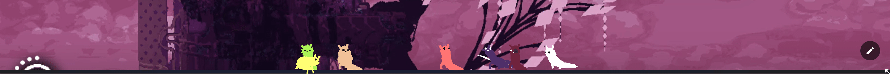
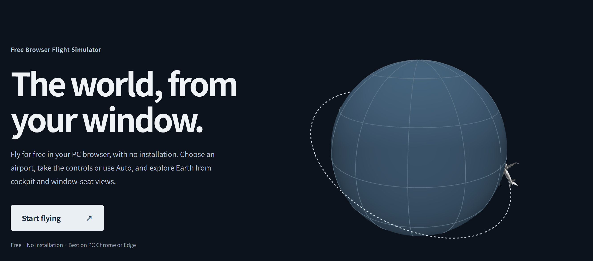
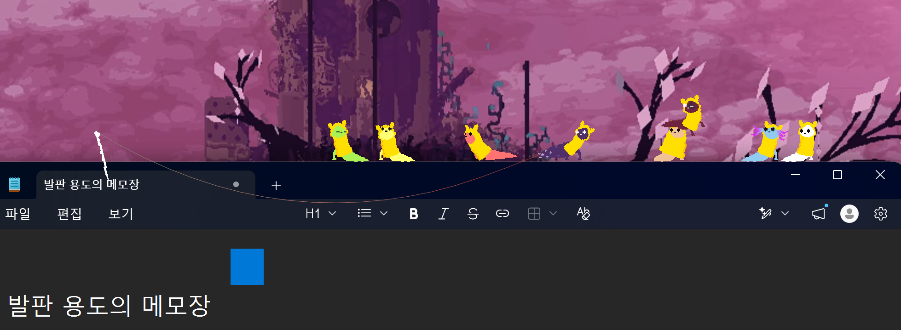

<div align="center">




<br>
<br>

[소개](#소개) &nbsp;·&nbsp; [개인&nbsp;프로젝트](#개인-프로젝트) &nbsp;·&nbsp; [서브&nbsp;프로젝트](#서브-프로젝트) &nbsp;·&nbsp; [기술&nbsp;스택](#기술-스택) &nbsp;·&nbsp; [만들어&nbsp;내는&nbsp;것들](#만들어-내는-것들)

</div>

<br>

## 소개

- 원하는 것들을 만들어내는 **프론트엔드 개발자**입니다.
- **UI/UX, 상호작용**을 중요하게 생각합니다.
- 인터페이스, 데스크톱 앱, 조금 이상한 사이드 프로젝트를 만드는 걸 좋아합니다.
- 주로 **웹 기술**을 사용하고, 개인 프로젝트에서는 **C#과 .NET**도 다룹니다.
- 현재 [AirplaneInWeb](https://airplaneinweb.com)을 제작하고 있으며 실제 배포까지 진행하고 있습니다.

<br>

## 개인 프로젝트

### AirPlane In Web

<p>
  <a href="https://airplaneinweb.com"></a>
  
</p>

지구를 배경으로 자유롭게 여행하거나 자동으로 원하는 공항으로 이동하는 **웹 시뮬레이터**입니다.

<a href="https://airplaneinweb.com">
  
</a>

- 처음 원하는 공항에서 시작할 수 있으며 플레이어가 직접 항공기를 조작할 수 있습니다.
- Auto 기능을 통하여 편하게 여행하는 기분을 느낄 수 있습니다.
- 광고를 통한 수익화를 노리고 있으며 실제 배포까지 마친 개인 프로젝트입니다.
- 3D, 셰이더, 외부 오픈 API, 에셋, 카메라 등등 처음으로 다양한 기술들을 종합해서 만들었습니다.

<div align="center">

**[AirplaneInWeb 사이트 방문하기 →](https://airplaneinweb.com)**

</div>

<br>

## 서브 프로젝트

### Slugcat In My Monitor

<p>
  
  
</p>

게임 "레인 월드"에서 영감을 받아 만든 **윈도우 데스크톱 펫 프로젝트**입니다.

단순히 화면 위를 움직이는 스프라이트가 아니라,  
걷고, 점프하고, 창을 타고 넘나들며 작은 생물처럼 느껴지는 데스크톱 펫을 목표로 만들고 있습니다.



<br>

## 기술 스택

<table>
  <tr>
    <th align="left" width="160">Frontend</th>
    <td>
      
      
      
    </td>
  </tr>
  <tr>
    <th align="left" width="160">Side Projects</th>
    <td>
      
      
      
      
      
    </td>
  </tr>
</table>

<br>

## 만들어 내는 것들

```text
Frontend & UI
├─ 인터랙티브 웹사이트
├─ 눈이 즐거운 디자인
└─ UI/UX 실험

Side Projects
├─ 데스크톱 앱
├─ 간편한 웹 페이지 생성 웹
└─ 갑자기 생각나서 마음대로 만드는 것들...
```

<br>

<div align="center">


### 들러주셔서 감사합니다!

<!-- SLUGCAT-PROFILE:START -->
<picture>
  <source media="(prefers-reduced-motion: reduce) and (prefers-color-scheme: dark)" srcset="./assets/slugcat/slugcat-dark-static.svg">
  <source media="(prefers-reduced-motion: reduce)" srcset="./assets/slugcat/slugcat-light-static.svg">
  <source media="(prefers-color-scheme: dark)" srcset="./assets/slugcat/slugcat-dark.svg">
  
</picture>
<!-- SLUGCAT-PROFILE:END -->

</div>
